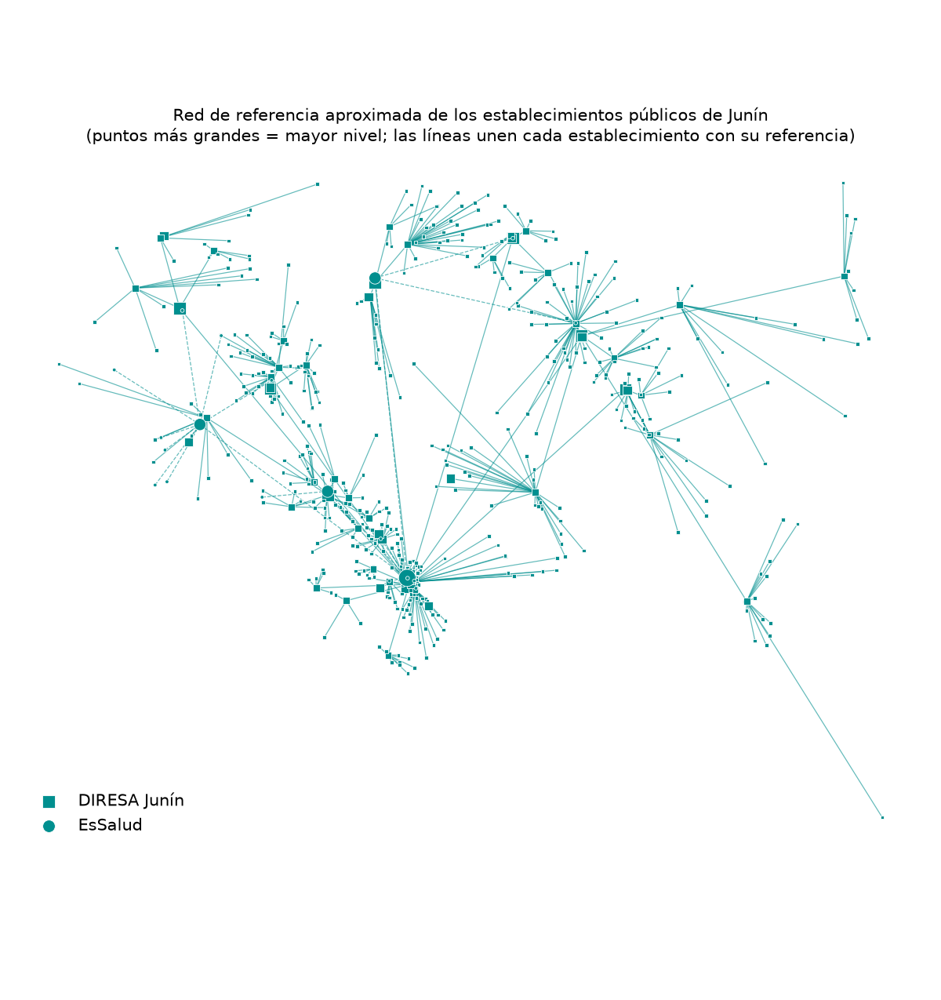

# Incendios en Junín · ¿a quién afecta y puede responder la red de salud?

Ciencia de Datos con Python · Camino **D** («¿A quién afecta?»), con dos aportes propios: **criterios de evidencia** para separar incendios reales de otros focos de calor, y la **red pública de salud** (DIRESA y EsSalud) con su conectividad y sus tiempos de traslado.

**Página web:** https://claude.ai/artifact/2fVRwcStbC5LgvMmfuYn8h

## Preguntas

1. ¿Cuáles de los focos de calor detectados en Junín entre el 14 y el 21 de octubre de 2026 son **probablemente incendios forestales**?
2. ¿Cuántas personas y qué establecimientos de salud están a **5 km o menos** de ellos?
3. Si un establecimiento expuesto recibe heridos, ¿tiene **señal para una teleconsulta** y un **hospital a distancia razonable** para trasladarlos?

Es una evaluación inicial de **exposición por cercanía**. Busca ordenar dónde mirar primero. No mide personas damnificadas.

## ¿Para qué le sirve al Gobierno Regional de Junín?

| Pregunta del gobernador | Qué muestra el producto | Con quién coordinar |
|---|---|---|
| ¿Dónde hay fuego real ahora? | Incendios forestales probables con actividad en 72 h y un semáforo por distrito | COER Junín y las municipalidades |
| ¿A cuántas personas tiene cerca? | Personas a ≤ 5 km, sin contar dos veces a nadie, por incendio y por distrito | Las municipalidades de los distritos en prioridad alta |
| ¿Puede responder la red de salud? | Establecimientos expuestos, su hospital de referencia, el tiempo de traslado y su señal 4G | DIRESA Junín (redes y microrredes) y la Red Asistencial de EsSalud |

## Datos y fechas

| Capa | Fuente | Tipo | Fecha |
|---|---|---|---|
| Focos de calor | NASA FIRMS, VIIRS 375 m (S-NPP, NOAA-20, NOAA-21), archivo de 7 días | Puntos | 14–21 oct 2026 |
| Cobertura del suelo | ESA WorldCover, 10 m, vía Microsoft Planetary Computer (recurso del profesor) | **Raster** | 2021 |
| Luces nocturnas | VIIRS, compuesto anual (raster del notebook del profesor) | **Raster** | 2021 |
| Población | WorldPop, 100 m (R2024B, *constrained*) | **Raster** | estimación 2026 |
| Tiempo de viaje | Malaria Atlas Project, fricción motorizada (Weiss et al., 2020) | **Raster** | 2019 |
| Establecimientos de salud | RENIPRESS, SUSALUD (datos abiertos) | Puntos | corte 30-09-2026 |
| Cobertura móvil | OSIPTEL, % de cobertura garantizada por centro poblado, operador y tecnología | Puntos | 2025 |
| Distritos | INEI, límites del Censo 2017, con UBIGEO | Polígonos | 2017 |

## Método

El código está en dos scripts. La red de salud es una **capa base** que cambia una vez al mes. Los incendios se actualizan cada vez que se quiere, sin recalcular la red.

| Script | Cuándo | Procesos |
|---|---|---|
| `red_salud_junin.py` | Una vez al mes | R1 establecimientos · R2 rol de cada uno · R3 tiempo de viaje · R4 enlaces de referencia · R5 conectividad · R6 tablas · R7 imagen |
| `incendios_junin.py` | En cada actualización (~10 s) | 1 distritos · 2 focos · 3 limpieza · 4 incendios · **5 evidencia** · 6 zona de 5 km · 7 población · 8 salud · **9 red de salud** · 10 tablas · 11 ficha territorial · 12 mapa · 13 imagen · 14 página web |

### 1. Incendios y criterios de evidencia (Procesos 4 y 5)

Dos focos son del mismo incendio si están a ≤ 1 km y a ≤ 48 h entre sí (la regla del profesor). Luego cada incendio se clasifica con cuatro pistas:

| Pista | Qué descarta | Fuente |
|---|---|---|
| Persistencia: focos en 2 o más pasadas del satélite | Destellos de un solo momento | FIRMS |
| Coincidencia: detectado por 2 o más satélites | Errores de un solo sensor | FIRMS |
| Cobertura del suelo: clase más frecuente en ~375 m alrededor de cada foco | Quemas en cultivos y focos en zonas construidas | WorldCover |
| Luz nocturna ≥ 5 nW/cm²/sr en el foco | Fuentes de calor de ciudades o industrias | Luces nocturnas VIIRS |

| Nivel | Regla |
|---|---|
| **Incendio forestal probable** | ≥ 3 focos, ≥ 2 pasadas o ≥ 2 satélites, ≥ 50 % de focos en vegetación natural y < 50 % de confianza baja |
| Probable quema agropecuaria | ≥ 50 % de los focos en cultivos |
| Probable fuente no forestal | ≥ 50 % de los focos en zona construida o con luz nocturna alta |
| Detección por verificar | Todo lo demás (casi siempre 1 o 2 focos) |

La exposición (población y salud) se calcula **solo con los incendios forestales probables**.

### 2. Población (Procesos 6 y 7)

Se trazan círculos de 5 km alrededor de los focos y se unen antes de sumar, para no contar dos veces a nadie. Luego se suma el raster WorldPop dentro de esa zona con estadística zonal (`zonal_stats`, `sum`, `nodata = −99999`).

### 3. Red de salud (`red_salud_junin.py` y Proceso 9)

- **Nodos:** los establecimientos activos y categorizados del Gobierno Regional, MINSA y EsSalud en Junín.
  - 547 nodos: 527 de la DIRESA y 20 de EsSalud.
  - 17 establecimientos de una sola especialidad (salud mental, materno-infantil, oncología) quedan fuera del árbol.
- **Enlaces (aproximación con RENIPRESS):**
  - DIRESA: establecimiento → cabecera de su microrred (la de mayor categoría) → hospital de su red → Hospital Daniel Alcides Carrión.
  - EsSalud: establecimiento → hospital EsSalud más rápido de alcanzar → Hospital Ramiro Prialé.
  - Si una red no tiene hospital, se elige el que se alcanza más rápido.
- **Tiempo de traslado:** camino de menor costo sobre el raster de fricción motorizada (`skimage.graph.MCP_Geometric`).
- **Señal:** % del centro poblado más cercano (≤ 1.5 km) con 4G garantizado según OSIPTEL. Se considera "4G garantizado" desde el 50 %.
- **Alerta** para establecimientos a ≤ 5 km de un incendio forestal probable:
  - **Crítico:** primer nivel, **sin 4G garantizado y a más de 2 h** de su hospital.
  - **Atención:** primer nivel que cumple solo una de esas dos condiciones.
  - **Expuesto:** el resto (tiene 4G y hospital a menos de 2 h, o es un hospital).

## Tres hallazgos

1. **Los criterios cambian la cifra.**
   - Si se cuenta cualquier foco, **746,046 personas** estarían a ≤ 5 km del fuego. Con los criterios quedan **232,748**, y **68,392** cerca de incendios con actividad en las últimas 72 h. Es decir, el **69 %** de las personas "cerca del fuego" lo estaba de focos sin evidencia de incendio forestal.
   - El foco aislado de Chilca (Huancayo), con 294,603 personas a 5 km, queda **por verificar**.
   - Los 12 focos de La Unión (Tarma), todos sobre zona construida, se descartan como **probable fuente no forestal**.
   - De 349 grupos de focos, **80 son incendios forestales probables**: 64 en bosque y 16 en pastizal.
2. **El incendio más grande no es el que expone a más personas.** El de Río Tambo (Satipo; INC-001) tuvo **287 focos** en 7 pasadas y por los 3 satélites, sobre bosque, con una huella de unas **1,958 ha**. Aun así, solo **399 personas** y 1 establecimiento de salud quedan a ≤ 5 km.
3. **El punto débil de la red está en el valle del Ene.**
   - **97 de 547** establecimientos públicos están a ≤ 5 km de un incendio forestal probable: **7 críticos** y **61 en atención**.
   - **6 de los 7 críticos** están en Río Tambo y Vizcatán del Ene, refieren al Hospital Manuel Higa Arakaki (Satipo), a 3 o 4 h estimadas, y ninguno tiene 4G garantizado.
   - En toda la red, **379 de 547** establecimientos (371 de 527 de la DIRESA y 8 de 20 de EsSalud) no tienen 4G garantizado. La teleconsulta no está asegurada justo donde más se necesitaría.

## Mapas




Hay dos versiones interactivas:
- **La página web** (enlace arriba). Incluye un mapa propio con capas, el panel «Para decidir hoy», los criterios de evidencia y un **árbol de referencia por hospital**.
- **El mapa Folium** `salidas/mapa_incendios_junin.html`. Descárguelo y ábralo en el navegador.

Tablas en `salidas/`:
- `incendios_junin.csv`: cada incendio con su nivel de evidencia y sus pistas.
- `ficha_distritos_junin.csv`: el semáforo por distrito y los puntos críticos.
- `red_salud_nodos.csv` y `red_salud_enlaces.csv`: el grafo (capa base).
- `red_salud_alertas.csv` y `red_salud_por_hospital.csv`: las alertas de la red ante el fuego.
- `establecimientos_expuestos.csv` y `distritos_poblacion_expuesta.csv`.

## Cumplimiento de la tarea (camino D)

| Lo que se pide | Dónde está |
|---|---|
| Ubicar las detecciones de los incendios | Procesos 2–4 |
| Construir una zona de 5 km | Proceso 6 |
| Cruzarla con el raster de población y sumar | Proceso 7: `zonal_stats(sum)` sobre WorldPop |
| Evitar contar dos veces a las mismas personas | Proceso 6: `union_all` antes de sumar |
| Un mapa y una tabla por incendio o distrito | Mapas, `incendios_junin.csv` y `ficha_distritos_junin.csv` |
| Aclarar que «cercanía» no es «damnificados» | Leyendas y limitaciones |
| README con pregunta, datos, método, 3 hallazgos, mapa y limitaciones | Este archivo |
| Al menos un dato raster | Cuatro: WorldPop, WorldCover, luces nocturnas y fricción |
| Nivel «excelente»: tablero HTML que cuente el hallazgo | La página web |

## Limitaciones

- **«Probable» no es «confirmado».** Los criterios reducen las falsas alarmas, pero no recuperan incendios ocultos por nubes o humo. Además, WorldCover no distingue una quema de pastos de un incendio de pastizal. Confirmar un incendio requiere imágenes Sentinel-2 o un reporte de campo.
- **Personas cercanas no son damnificadas.** WorldPop es una estimación con un modelo, no un censo.
- **El grafo es una aproximación.** RENIPRESS trae la red y la microrred, no los flujos oficiales de referencia y contrarreferencia.
- **El tiempo de traslado es modelado** (vías y terreno de 2019, con un vehículo disponible). No considera ríos navegables ni el estado de las carreteras, y en la selva tiende a subestimar.
- **La cobertura 4G es la que declaran los operadores a OSIPTEL.** No hay datos abiertos de ambulancias ni de establecimientos con telesalud, aunque el DL 1490 obliga a publicar estos últimos.
- **RENIPRESS no trae camas**, y su «estado» es el del registro.
- Los límites distritales son los del Censo 2017.

## Cómo ejecutarlo

```bash
uv pip install -r requirements.txt   # una sola vez
python red_salud_junin.py            # capa base de la red de salud (una vez al mes)
python incendios_junin.py            # focos del día, evidencia, exposición, mapas y web (~10 s)
```

La primera ejecución descarga los datos base: WorldPop, RENIPRESS, luces nocturnas, el raster de fricción y OSIPTEL. También lee WorldCover para cada foco (~1 min) y guarda esa clasificación para no repetirla. La ruta del shapefile de distritos se configura en el **Proceso 0**.

## Siguientes pasos

- Confirmar con Sentinel-2 (dNBR) los incendios prioritarios, empezando por Río Tambo.
- Pedir a la DIRESA los flujos oficiales de referencia y la lista de IPRESS con telesalud, y reemplazar la aproximación.
- Agregar las rutas fluviales al tiempo de traslado en el valle del Ene.
