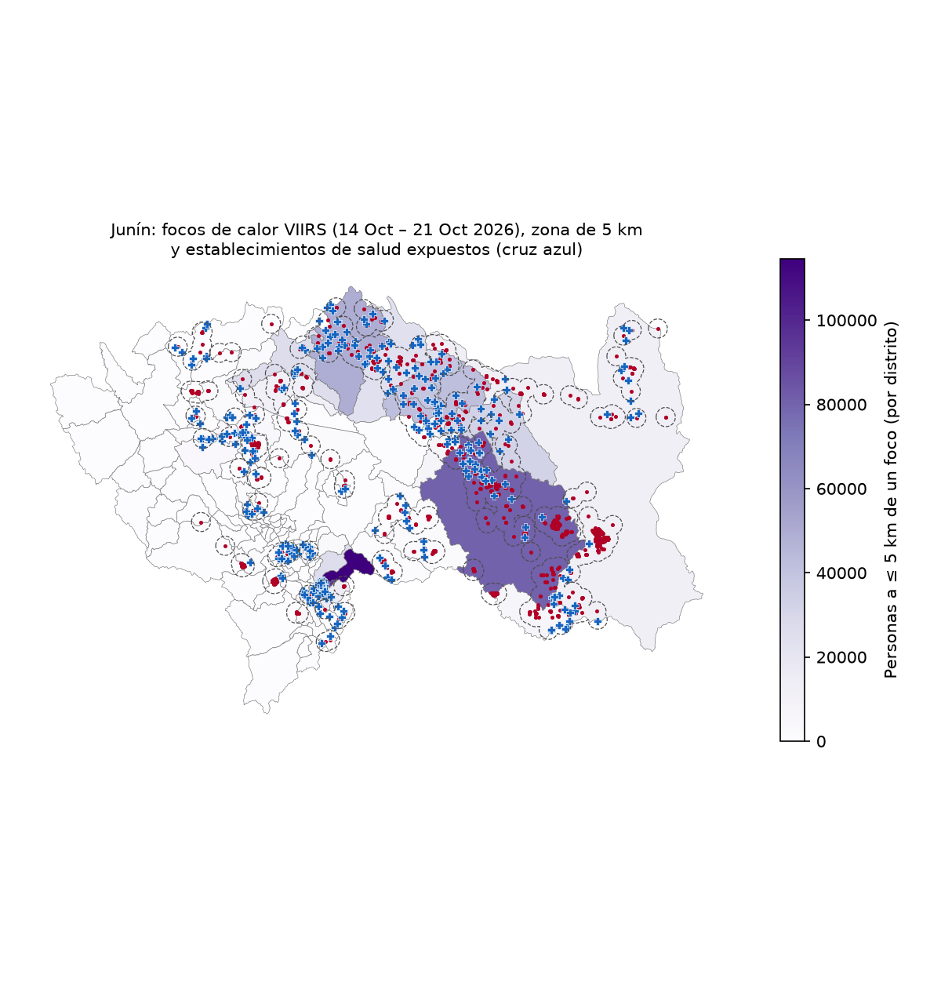

# Incendios en Junín · ¿a quién afecta?

Avance del 21 de octubre de 2026 · Ciencia de Datos con Python · Camino **D** («¿A quién afecta?»), con los establecimientos de salud como valor agregado.

## Pregunta

¿Cuántas personas y qué establecimientos de salud están a **5 km o menos** de los focos de calor detectados por satélite en **Junín** entre el 14 y el 21 de octubre de 2026?

Es una evaluación inicial de **exposición por cercanía**. Busca ordenar dónde mirar primero. No mide personas damnificadas.

## ¿Para qué le sirve al Gobierno Regional de Junín?

Responde a tres preguntas que se pueden decidir **hoy**, según las unidades con las que trabaja el Gobierno Regional:

| Pregunta del gobernador | Qué muestra el producto | Con quién coordinar |
|---|---|---|
| ¿Dónde hay fuego ahora? | Semáforo por distrito y un ícono 🔥 por cada incendio con actividad en las últimas 72 h | COER Junín y las municipalidades provinciales y distritales (plataformas de defensa civil) |
| ¿A cuántas personas tiene cerca? | Personas a ≤ 5 km de cada incendio y de cada distrito (sin doble conteo) | Las municipalidades de los distritos de prioridad alta |
| ¿Qué establecimientos de salud alertar? | Los establecimientos a ≤ 5 km, agrupados por **red de salud** | DIRESA Junín: redes y microrredes |

**Regla del semáforo**, una por distrito y explicable en una frase:
- **Alta:** tiene un incendio de ≥ 3 focos con actividad en las últimas 72 h.
- **Media:** tiene focos recientes, pero aislados.
- **Baja:** solo tiene focos de hace más de 72 h.

## Datos y fechas

| Capa | Fuente | Tipo | Fecha |
|---|---|---|---|
| Focos de calor | NASA FIRMS, VIIRS 375 m (S-NPP, NOAA-20, NOAA-21), archivo de 7 días | Puntos (CSV) | 14–21 oct 2026 (corte: 21 oct, ~21:00, hora de Lima) |
| Población | WorldPop 2026, 100 m (R2024B, *constrained*) | **Raster** | estimación 2026 |
| Establecimientos de salud | RENIPRESS, SUSALUD (Plataforma Nacional de Datos Abiertos) | Puntos (CSV) | corte 30-09-2026 |
| Distritos | INEI, límites del Censo 2017, con UBIGEO | Polígonos | 2017 |

## Método

1. **Focos:** se descargan los 3 satélites. La hora pasa de UTC a hora de Lima (−5 h). Se conservan solo los focos dentro de los distritos de Junín: **1,329 focos**. Los 88 de confianza baja se conservan, pero se marcan.
2. **Incendios:** dos focos pertenecen al mismo incendio si están a ≤ 1 km y a ≤ 48 h entre sí (la regla del profesor). Resultado: **349 incendios**, de los que 92 tienen 3 o más focos. Al corte, 10 están activos (foco en las últimas 24 h) y 76 en observación (24–72 h).
3. **Zona de focos (huella):** el cuadrado de 375 m de cada píxel con fuego. **No es un perímetro confirmado**: no existen perímetros oficiales como datos abiertos.
4. **Zona de 5 km** alrededor de los focos. Todas las zonas se unen antes de sumar, para no contar dos veces a las mismas personas.
5. **Población:** estadística zonal (`zonal_stats`, `sum`) del raster WorldPop dentro de cada zona, por incendio, en total y por distrito, con `nodata = −99999` declarado.
6. **Salud:** RENIPRESS filtrado en cascada:
   - 36,128 registros
   - 26,972 activos
   - 24,076 establecimientos (sin contar los servicios de apoyo)
   - 22,051 categorizados
   - **17,868 con coordenadas válidas**

   Para cada uno se mide la distancia al foco más cercano.

## Tres hallazgos

1. **El incendio más grande no es el que expone a más personas.** El de Río Tambo (Satipo; INC-001) tuvo 287 focos y una huella de unas 1,958 ha entre el 14 y el 17 de octubre. Solo **399 personas** y **1 establecimiento de salud** quedan a ≤ 5 km.
2. **Un solo foco cerca de una ciudad puede inflar la cifra.** Un foco aislado en Chilca (Huancayo; 17 oct, 13:49 h, 5.3 MW) deja **294,603 personas** y **189 establecimientos** dentro de 5 km. Probablemente no es un incendio forestal y hay que verificarlo. Por eso hay dos totales:
   - a ≤ 5 km de cualquier foco: **746,046 personas** (57 % de 1,306,011 habitantes de Junín);
   - a ≤ 5 km de incendios con ≥ 3 focos: **268,399 personas**.
3. **Hoy la prioridad está en la selva central.**
   - **7 de los 11 distritos de prioridad alta** están en Satipo y Chanchamayo. Encabeza **Pangoa**: 10 incendios prioritarios, 80,584 personas y 35 establecimientos de salud a ≤ 5 km.
   - En toda la región hay **86 incendios con actividad en las últimas 72 h**, con **192,435 personas** y **117 establecimientos de salud** a ≤ 5 km.
   - La red de salud más expuesta es **Satipo** (38 establecimientos cerca de incendios recientes), seguida de San Martín de Pangoa (17).
   - Casi todos los establecimientos expuestos son de primer nivel (categorías I-1 a I-3).

## Mapa



Mapa interactivo: `salidas/mapa_incendios_junin.html`. Descárguelo y ábralo en el navegador. Incluye el panel **«Para decidir hoy»** y la leyenda **«Cómo leer el mapa»**.

Cada tema tiene un color propio, para que no se confundan:

| Color | Tema | Qué incluye |
|---|---|---|
| Morado | Territorio | Provincias (línea gruesa), distritos (línea delgada) y relleno según la prioridad |
| Rojo, naranja y amarillo | Fuego | Focos según su antigüedad, la zona de focos y el ícono 🔥 de cada incendio |
| Azul | Salud | Cuadrado con cruz: relleno si es público, borde si es privado |
| Gris punteado | Exposición | Los 5 km alrededor de los focos; **no es el avance del fuego** |

Tablas en `salidas/`:
- `ficha_distritos_junin.csv`: semáforo e indicadores por distrito.
- `salud_por_red_junin.csv`: establecimientos expuestos por red de salud.
- `incendios_junin.csv`
- `distritos_poblacion_expuesta.csv`
- `establecimientos_expuestos.csv`

## Cumplimiento de la tarea (camino D)

| Lo que se pide | Dónde está |
|---|---|
| Ubicar las detecciones de los incendios | Procesos 2–4: focos FIRMS agrupados en incendios (≤ 1 km y ≤ 48 h) |
| Construir una zona de 5 km | Proceso 5 |
| Cruzarla con el raster de población y sumar | Proceso 6: `zonal_stats(sum)` sobre WorldPop 2026 (**el dato raster**) |
| Evitar contar dos veces a las mismas personas | Proceso 6: las zonas se unen (`union_all`) antes de sumar |
| Un mapa y una tabla por incendio o distrito | `mapa_incendios_junin.html`, `mapa_junin.png`, `incendios_junin.csv` y `ficha_distritos_junin.csv` |
| Aclarar que «cercanía» no significa «damnificados» | Leyenda del mapa y sección de limitaciones |
| README con pregunta, datos, método, 3 hallazgos, mapa y limitaciones | Este archivo |
| Valor agregado | Establecimientos de salud (RENIPRESS), el semáforo territorial y el resumen por red de salud |
| Nivel «excelente»: un tablero HTML que cuente el hallazgo | El mapa interactivo con el panel «Para decidir hoy» |

## Limitaciones

- **Un foco de calor no es un incendio:** incluye quemas agrícolas y de pastos y fuentes de calor urbanas. Las nubes y el humo pueden esconder el fuego, y VIIRS solo pasa hacia la 01:30 y las 13:30 h.
- **Personas cercanas no son personas damnificadas.** WorldPop es una estimación con un modelo, no un censo.
- La huella de 375 m **no es el área quemada**. Medirla requiere Sentinel-2 (dNBR, camino A).
- **RENIPRESS no trae camas.** El «estado» es el del registro, no si el establecimiento funciona después del incendio. El 36 % de los registros no tiene coordenadas (en la red pública casi todos sí).
- Los límites son de 2017: los distritos creados después no aparecen.
- La ventana es de solo 7 días (el archivo gratuito de FIRMS sin clave).

## Cómo ejecutarlo

```bash
uv pip install -r requirements.txt   # una sola vez
python incendios_junin.py            # descarga los focos del día y rehace el análisis (~15 s)
```

El script descarga WorldPop y RENIPRESS solo la primera vez. En cada ejecución vuelve a bajar los focos y los guarda en una carpeta con la fecha. La ruta del shapefile de distritos se configura en el **Proceso 0**.

## Siguientes pasos

- Ampliar al resto del país.
- Agregar edificaciones (Google Open Buildings) y centros poblados (IGN).
- Medir el área quemada con dNBR en el incendio de Río Tambo.
